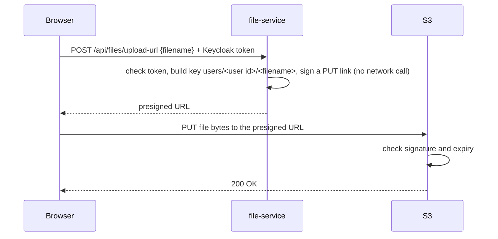

# S3 and presigned URLs

How file uploads and downloads work in NexusDrive, what "signing" a URL means, and why file-service has two S3 settings (`S3_ENDPOINT` and `S3_PUBLIC_ENDPOINT`).

**Short version:** the browser uploads and downloads files directly to and from S3, using short-lived links that file-service signs. A signed link only works at the address it was signed for. In Docker, the browser and file-service reach S3 at different addresses, so file-service now uses one address for its own calls and another for the links it gives the browser.

## How files move

File bytes never go through file-service. It only hands out links:



Downloads work the same way with a signed GET link (`GET /api/files/:name/download-url`). Listing and deleting files are done by file-service itself, calling S3 directly.

This keeps large files off the Node services, so they stay small and can scale freely.

## What "signing" means

The bucket is private. S3 only accepts requests that prove they come from someone holding the access keys. The browser must never have those keys, but file-service does.

So file-service writes the browser a permission slip:

1. It takes the request details: method (`PUT`), address, bucket and file path, current time, and how long the link is valid.
2. It runs them through **HMAC-SHA256** together with the **secret access key**. The result is a long hex string, the **signature**. Only someone with the secret can produce it for those exact details.
3. It puts the details and the signature into the URL's query string.

When the browser sends the request, S3 repeats the same calculation with its own copy of the secret:

- same result and not expired → accepted
- anything changed (another file, another address, too late) → `403 Forbidden`

Every request to S3 is signed this way, including file-service's own list and delete calls. For those, the AWS SDK puts the signature in a header and sends the request immediately. A **presigned URL** is the same signature placed in the URL, so someone else can send the request later.

Two facts matter for the rest of this page:

- **Signing never contacts S3.** It's a calculation inside file-service.
- **The address (host) is part of what's signed.** You can't sign a link for one address and then swap in another.

## Anatomy of a presigned URL

A real upload link from file-service, split onto lines:

```
http://localhost:9000                                  ← address the browser uses (signed)
/nexusdrive-files/users/3f2a91c4/report.pdf            ← bucket + object key (signed)
?X-Amz-Algorithm=AWS4-HMAC-SHA256                      ← signing method (AWS Signature V4)
&X-Amz-Credential=minioadmin/20261126/eu-central-1/s3/aws4_request
                                                       ← access key ID (public half) + date/region/service
&X-Amz-Date=20261126T160359Z&X-Amz-Expires=900         ← signed at, valid for 900 s (PRESIGN_TTL_SECONDS)
&X-Amz-SignedHeaders=host                              ← the host header is part of the signature
&X-Amz-Signature=bdff7575…8054552                      ← the signature itself
&X-Amz-Content-Sha256=UNSIGNED-PAYLOAD&x-id=PutObject  ← file contents not signed; operation hint
```

The secret key is never in the URL. Only its access key ID is, so S3 knows which secret to check with.

## The Docker problem: one S3, two addresses

When everything runs in containers, the browser and file-service reach the same S3 container by different addresses:

```
your machine
├── browser ──► localhost:9000 ──(port mapping)──┐
│                                                ▼
└── Docker network "nexusdrive"
    ├── file-service ──► http://s3:8333 ──► s3 container (listens on 8333)
    └── s3
```

| Who connects           | `http://localhost:9000`                                        | `http://s3:8333`                               |
| ---------------------- | -------------------------------------------------------------- | ---------------------------------------------- |
| Browser                | works, through the port mapping                                | fails: your machine doesn't know the name `s3` |
| file-service container | fails: inside a container, `localhost` is the container itself | works, through Docker's internal names         |

Before the fix, file-service had a single setting, `S3_ENDPOINT`, used both for its own calls and for signing links, so one side always broke:

- `S3_ENDPOINT=http://localhost:9000`: links work, but file-service can't list or delete, and `/ready` fails.
- `S3_ENDPOINT=http://s3:8333`: file-service works, but every link points at `s3:8333`, which the browser can't open.

## The fix: two clients, two jobs

Because signing never contacts S3, the client that signs doesn't need to be able to reach the address it writes into the link. So file-service now has two S3 clients ([storage.service.ts](../services/file-service/src/storage/storage.service.ts)):

| Client      | Address                                           | Used for                                                         |
| ----------- | ------------------------------------------------- | ---------------------------------------------------------------- |
| `s3`        | `S3_ENDPOINT`                                     | file-service's own calls: list, delete, the `/ready` check       |
| `presigner` | `S3_PUBLIC_ENDPOINT`, or `S3_ENDPOINT` when unset | only signing upload and download links; never opens a connection |

Both are built from the same settings (region, keys, path style, checksum options), so they differ only in address. When `S3_PUBLIC_ENDPOINT` is unset or the same as `S3_ENDPOINT`, `presigner` is simply the same client, which is the old behaviour.

One detail that makes this work: the browser sends `Host: localhost:9000`, and Docker's port forwarding doesn't rewrite it. So S3 sees the same host that was signed, and the signature matches.

## What to set where

| Where it runs                                 | `S3_ENDPOINT`           | `S3_PUBLIC_ENDPOINT`         | Why                                                                            |
| --------------------------------------------- | ----------------------- | ---------------------------- | ------------------------------------------------------------------------------ |
| `npm run dev`                                 | `http://localhost:9000` | empty                        | file-service runs on your machine, so it and the browser share one address     |
| Docker (`deploy/docker-run/file-service.env`) | `http://s3:8333`        | `http://localhost:9000`      | two sides, two addresses                                                       |
| Compose / kind                                | the S3 service's name   | the address the browser uses | same situation as Docker                                                       |
| AWS (EKS)                                     | empty                   | empty                        | real S3 has one address that pods and browsers both reach; keys come from IRSA |

Other S3 settings are listed in [services/file-service/.env.example](../services/file-service/.env.example) and [deployment-notes.md](deployment-notes.md#service-configuration).

## Checking it works

1. `curl localhost:3001/ready` reports the `s3` check as OK. That proves the `s3` client reaches S3.
2. Upload a file in the browser at http://localhost:5173 and download it again. That proves the `presigner`'s links work.

If uploads fail but `/ready` is fine, open the browser's network tab and look at the PUT request:

- **It goes to `s3:8333`:** `S3_PUBLIC_ENDPOINT` isn't set.
- **A 403 with `SignatureDoesNotMatch`:** the address was changed after signing (for example by a proxy rewriting the host).
- **A CORS error:** the bucket's CORS rule doesn't allow `http://localhost:5173`.
